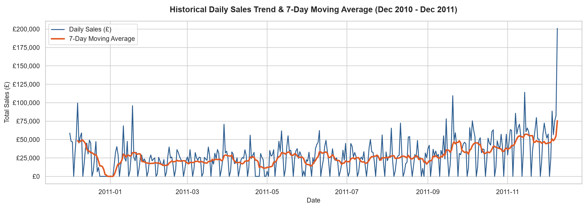
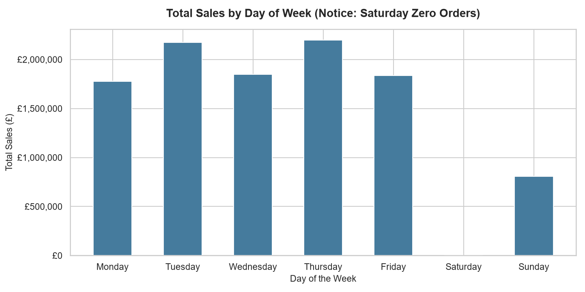
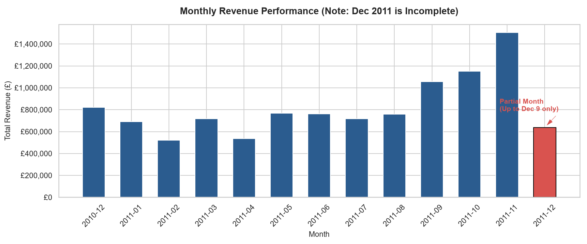
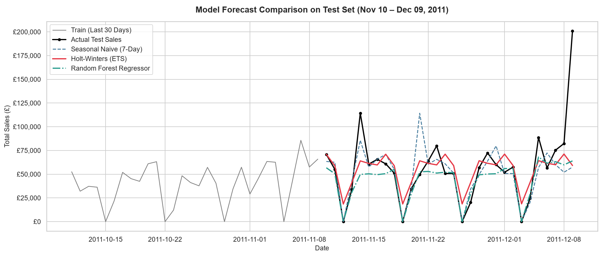

# 🛒 Retail Sales Forecasting Using Python
> **Predicting Future Sales from Historical Retail Transactions**

[](https://www.python.org/)
[](https://pandas.pydata.org/)
[](https://scikit-learn.org/)
[](https://www.statsmodels.org/)
[](LICENSE)

---

## 📌 Executive Summary & Business Problem

Dalam industri retail dan e-commerce, **perencanaan persediaan (*inventory management*)** dan alokasi operasional sangat bergantung pada keakuratan estimasi permintaan pelanggan di masa mendatang. 
* **Over-stocking:** Mengakibatkan biaya penyimpanan (*holding cost*) membengkak, penurunan arus kas, dan risiko barang rusak/kedaluwarsa.
* **Under-stocking:** Menyebabkan kehabisan stok (*stockout*), hilangnya potensi pendapatan (*lost sales*), serta penurunan kepuasan pelanggan.

Proyek ini bertujuan untuk membangun sistem peramalan penjualan (*sales forecasting*) yang dapat memprediksi total nilai transaksi harian toko dengan membandingkan metode **Baseline**, **Model Deret Waktu Statistik (Holt-Winters ETS)**, dan **Machine Learning (Random Forest Regressor)**.

---

## 📂 Struktur Repositori

```text
retail-sales-forecasting/
├── data/
│   └── Online Retail.xlsx         # Dataset transaksi retail dari UCI ML Repository
├── images/                        # Visualisasi hasil analisis dan perbandingan model
│   ├── sales_trend_daily.png
│   ├── sales_monthly.png
│   ├── sales_by_dayofweek.png
│   └── forecast_comparison.png
├── notebooks/
│   └── retail_sales_forecasting.ipynb  # End-to-end Jupyter Notebook interaktif
├── requirements.txt               # Daftar dependensi Python
└── README.md                      # Dokumentasi komprehensif proyek
```

---

## 📊 Dataset & Logika Pembersihan Data (Data Cleaning)

Dataset yang digunakan bersumber dari **UCI Machine Learning Repository — Online Retail Dataset**, yang mencakup transaksi toko souvenir dan hadiah online berbasis di Inggris (*UK*) dari tanggal **1 Desember 2010 sampai 9 Desember 2011**.

### Keputusan Pembersihan Berdasarkan Rasional Bisnis:
1. **Deduplikasi (Deduplication):** Sebanyak `5.268` baris duplikat identik dihapus untuk mencegah *double-counting* nilai omset.
2. **Mempertahankan `CustomerID` Kosong:** Sekitar `24,9%` transaksi tidak memiliki `CustomerID` (pembeli tamu/*guest checkout*). Baris ini **tetap dipertahankan** karena uang dari pembeli tamu tetap merupakan pendapatan riil toko. Menghapusnya akan menyebabkan bias *underestimation* sebesar ~25%.
3. **Penyaringan `UnitPrice <= 0`:** Terdapat `2.512` baris dengan harga nol atau negatif yang merupakan catatan inventaris gudang (*damaged*, *lost*, *adjustment*), bukan transaksi jual-beli ke konsumen.
4. **Penyaringan `Quantity <= 0`:** Faktur berawalan huruf 'C' (*cancellations*) dan kuantitas negatif dipisahkan agar fokus analisis adalah **Gross Sales Demand** (permintaan belanja riil).
5. **Feature Engineering `TotalAmount`:** Dibuat dari formula $\text{TotalAmount} = \text{Quantity} \times \text{UnitPrice}$ sebagai target omset harian toko.

Dataset bersih menghasilkan **`524.878` baris transaksi valid** dengan total omset kotor sebesar **£10.642.110,80**.

---

## 🔍 Temuan Exploratory Data Analysis (EDA)

### 1. Tren Harian & Pola Musiman 7-Hari
Penjualan harian berfluktuasi tajam sesuai siklus mingguan, dengan tren kenaikan omset yang sangat kuat (*year-end surge*) menuju kuartal ke-4 (September – November 2011).



### 2. Pola Operasional Hari dalam Seminggu
* **Toko Libur di Hari Sabtu:** Toko retail ini **tidak memiliki transaksi sama sekali pada hari Sabtu (£0)**.
* **Hari Paling Sibuk:** Hari **Kamis (£2,19 Juta)** dan **Selasa (£2,17 Juta)** merupakan hari dengan volume pesanan tertinggi.



### 3. Anomali Data Parsial Desember 2011
Grafik bulanan menunjukkan lonjakan tajam pada bulan November 2011 (£1,5 Juta). Meskipun penjualan Desember 2011 tampak merosot drastis, ini terjadi murni karena pencatatan data **terpotong pada tanggal 9 Desember 2011 (bulan parsial)**, bukan karena penurunan performa bisnis.



---

## ⚙️ Metodologi Forecasting & Evaluasi

### 1. Pembagian Data Berbasis Waktu (Time-Based Split)
* **Training Set:** 1 Desember 2010 – 9 November 2011 (`344 hari`)
* **Test Set:** 10 November 2011 – 9 Desember 2011 (`30 hari terakhir` / periode puncak akhir tahun)

### 2. Model yang Diuji:
1. **Baseline 1 (Naive Last Day):** Mengasumsikan penjualan hari ini sama dengan kemarin ($\hat{y}_t = y_{t-1}$).
2. **Baseline 2 (Seasonal Naive 7-Day):** Mengasumsikan penjualan hari ini sama dengan hari yang sama pada minggu lalu ($\hat{y}_t = y_{t-7}$).
3. **Baseline 3 (7-Day Moving Average):** Menggunakan rata-rata bergerak 7 hari terakhir.
4. **Holt-Winters Exponential Smoothing (ETS):** Memodelkan komponen *additive trend* dan *additive seasonality* dengan siklus periode $s=7$.
5. **Machine Learning (Random Forest Regressor):** Memanfaatkan fitur lag (Lag 1, 2, 7, 14), 7-day rolling mean, hari dalam seminggu, tanggal, dan bulan.

---

## 🏆 Hasil Evaluasi Model

| Model | MAE (£) | RMSE (£) | MAPE (%) | Keterangan |
| :--- | :---: | :---: | :---: | :--- |
| **Machine Learning: Random Forest** | **£14.413,50** | **£29.696,64** | **19,84%** | 🥇 **Model Terbaik** (Error terendah) |
| **Baseline: Seasonal Naive (7-Day)** | £15.372,04 | £31.288,77 | 24,27% | Baseline terkuat; membuktikan pentingnya siklus mingguan |
| **Holt-Winters Exponential Smoothing** | £16.895,98 | £30.350,29 | 24,14% | Mampu menangkap tren & musiman secara stabil |
| **Baseline: 7-Day Moving Average** | £24.614,98 | £38.237,35 | 31,78% | Terlalu lambat merespons lonjakan akhir tahun |
| **Baseline: Naive (Last Day)** | £29.825,09 | £39.823,97 | 42,76% | Sangat buruk karena gagal menangani hari Sabtu (tutup) |

### Visualisasi Perbandingan Prediksi:


> **Insight Model:** *Seasonal Naive (7-Day)* berhasil memangkas error Naive biasa hampir 50% hanya dengan meniru pola hari yang sama minggu lalu. Model *Random Forest Regressor* menjadi yang terbaik karena mampu menggabungkan sinyal momentum jangka pendek (*Lag 1 & 2*) sekaligus pola musiman mingguan (*Lag 7 & 14*).

---

## 💡 Rekomendasi Bisnis & Perencanaan Stok

1. **Alokasi Sumber Daya Gudang & Logistik:**
   Karena hari Sabtu toko tidak beroperasi dan puncak transaksi terjadi pada hari **Selasa s.d. Kamis**, manajemen operasional disarankan memusatkan jam lembur staf pengepakan dan jadwal penjemputan kurir ekspedisi pada tengah minggu.
2. **Penetapan Safety Buffer Persediaan:**
   Dengan nilai rata-rata kesalahan prediksi model sebesar **~£14.400 per hari (MAPE ~19,8%)**, manajer persediaan disarankan menyediakan penyangga stok aman (*safety stock*) sebesar **15% – 20%** dari estimasi penjualan untuk produk *fast-moving* selama kuartal ke-4.
3. **Keterbatasan Proyek:**
   * Dataset hanya mencakup rentang waktu 1 tahun, sehingga musiman tahunan jangka panjang (*yearly seasonality*) belum dapat dimodelkan secara komprehensif.
   * Dataset tidak mencantumkan data eksternal seperti diskon promosi promosi, pengeluaran iklan marketing, maupun cuaca.

---

## 🚀 Cara Menjalankan Proyek Secara Lokal

1. **Clone repository ini:**
   ```bash
   git clone https://github.com/kemasmalfath/sales-forecasting-portfolio-project.git
   cd sales-forecasting-portfolio-project
   ```

2. **Buat dan aktifkan virtual environment (opsional namun disarankan):**
   ```bash
   python -m venv venv
   # Windows:
   venv\Scripts\activate
   # macOS/Linux:
   source venv/bin/activate
   ```

3. **Install dependensi:**
   ```bash
   pip install -r requirements.txt
   ```

4. **Jalankan notebook di Jupyter Lab / Notebook atau VS Code:**
   ```bash
   jupyter notebook notebooks/retail_sales_forecasting.ipynb
   ```

---

## 📬 Kontak & Profil
* **Author:** Kemas M. Alfath (Mahasiswa S1 Ilmu Komputer, Universitas Lampung)
* **Minat:** Data Science, Time Series Forecasting, Software Engineering
* **GitHub:** [kemasmalfath](https://github.com/kemasmalfath)
* **Repository:** [sales-forecasting-portfolio-project](https://github.com/kemasmalfath/sales-forecasting-portfolio-project)
